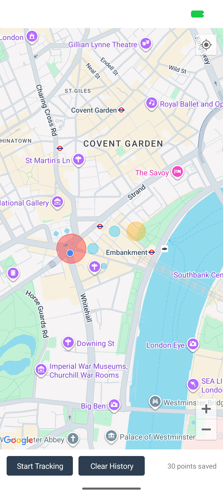

# Location Tracker (.NET MAUI)

A cross-platform (Android / iOS / Mac Catalyst) location tracking
app built with C# and .NET MAUI. It records the device's GPS position at a
fixed interval, stores every reading in a local SQLite database, and
visualizes the recorded path as a **heat map** drawn on top of the
`Microsoft.Maui.Controls.Maps` map control.

## Output

Red = most visited, orange = moderately visited, blue = passed through once.

## How it works

| Layer | File | Responsibility |
|---|---|---|
| Model | `Models/LocationPoint.cs` | One saved GPS reading (SQLite row). |
| Model | `Models/HeatMapCell.cs` | One grid cell + visit count used to render the heat map. |
| Data | `Services/DatabaseService.cs` | SQLite (via `sqlite-net-pcl`) CRUD for saved points. |
| Tracking | `Services/LocationTrackingService.cs` | Requests location permission and polls `Geolocation.Default.GetLocationAsync` every 15 seconds. |
| Rendering | `Services/HeatMapRenderer.cs` | **Extends** the Maps control: buckets points onto a lat/lon grid and draws one semi-transparent, color/size-scaled `Circle` per grid cell — producing the heat map effect. |
| UI | `MainPage.xaml` / `MainPage.xaml.cs` | Map view + Start/Stop/Clear controls, wires the services together. |
| Bootstrap | `MauiProgram.cs`, `App.xaml.cs` | Dependency injection setup (`DatabaseService`, `LocationTrackingService`, `MainPage` are all singletons). |

### Heat map approach

`Microsoft.Maui.Controls.Maps` has no built-in heat map layer, so one is
built on top of it:

1. Every saved GPS point is snapped onto a ~75-meter grid.
2. Points are grouped by grid cell, and the number of points per cell is its
   "heat" (visit count).
3. One `Circle` map element is drawn per cell. Both its **radius** and its
   **color** (blue → green → orange → red) scale with the visit count, so
   areas the user passed through once look different from areas they
   lingered in or passed through repeatedly.

## Running the project

1. Install the **.NET 10 SDK**, a **JDK 17 or 21**, and the MAUI Android
   workload (`dotnet workload install maui-android`), or use Visual Studio
   2022/2026 with the **.NET MAUI** workload.
2. Open `LocationTrackerMAUI.sln`, or build from the command line:
   `dotnet build LocationTrackerMAUI -t:Run -f net10.0-android`.
3. Copy `Platforms/Android/maps_api_key.example.xml` to
   `Platforms/Android/Resources/values/maps_api_key.xml` and replace
   `YOUR_GOOGLE_MAPS_API_KEY_HERE` with a Google Maps API key that has the
   **Maps SDK for Android** enabled (console.cloud.google.com). That file is
   git-ignored, so the key is never committed.
4. Select an Android emulator (or a physical device/iOS simulator) as the
   run target and press **Run**.
5. Grant the location permission when prompted, tap **Start Tracking**, and
   move around (or change the emulator's simulated GPS location) to see
   points accumulate and the heat map circles appear.

## Requirements covered

- C# / .NET MAUI, using the Maps component, extended with a custom heat map
  renderer (per assignment spec).
- Location is tracked and persisted to a local SQLite database
  (`Services/DatabaseService.cs`).
- Results are visualized as a heat map on the map (`Services/HeatMapRenderer.cs`).
- Code follows the Microsoft C# coding conventions (see `.editorconfig`),
  uses PascalCase/camelCase naming, and is commented throughout.
